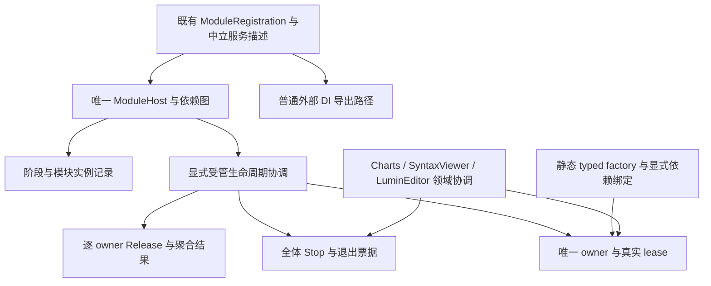

# Foundation 统一重构方案

状态：设计方向已按用户要求纳入正式文档；本文件保留方案依据与阶段安排，不作为独立权威合同。日期：2026-10-26。基线：`release/1.0` / `0041863`。产品实现未因文档更新而交付。

正式入口为[架构总览](overview.md)，具体合同见[模块宿主](modularity.md)、[服务登记](service-registration.md)、[受管生命周期](managed-lifetimes.md)、[源码生成](source-generation.md)与[验证合同](../engineering/verification.md)。下文的评审措辞和阶段讨论按当时方案保留；冲突时以这些正式分册为准。

建议保留 Foundation 的中立模块与服务描述层，修复已复现的宿主和生成器缺陷；另外新增显式启用的通用受管生命周期层，提供真实 owner/lease、全部 Stop 后的退出屏障、逐 owner 清理和共享 scope 关联。严格路径以静态 typed factory 与唯一 Release 权威为基线，不把包装 Microsoft DI provider 当作已满足生命周期保证。

这是补查消费端与外部评估后的修订方案。原来的“类型登记不创建实例就是残缺，应默认在核心内建 DI”判断已撤回：历史测试和 CLI 证明它是有真实消费者的原有描述模式。LuminEditor 的 Foundation-owned 服务分支则提出了确实需要补充的新能力，不能因为旧消费者可用就排除。

证据见[完整性与消费端审计](../engineering/2026-10-26-foundation-completeness-audit.md)；新增合同的技术论证见[生命周期扩展评估](2026-10-26-foundation-lifetime-extension-assessment.md)。本提案是设计与阶段验收，批准后再形成逐任务实施计划。

## 1. 目标与兼容边界

目标分为两部分：修复现有能力的实际错误；以真实消费需求增加可验证的服务寿命协议。默认登记描述不自动创建 provider，也不自动接管外部实例。

- 保留 `AtomUI.Modularity` 命名空间及既有公开签名，不删除原服务描述与实例入口。
- 保留 `net8.0` / `net10.0` 运行时支持；Generator 保持 `netstandard2.0`，不反向引用运行时。
- 手写 ModuleRegistration 与生成目录继续可用；模块身份、Required 图和 Host 仍只有一套。
- `AddSingleton(instance)` 的调用方所有权、冻结前查找实例、按服务类型最后一次登记覆盖和 Descriptors 导出保持原行为。
- 旧 Freeze 仍表示冻结登记。新增受管服务必须显式选择运行时和所有权策略，不通过改变 Freeze 偷偷启用第二个容器。
- 新增真实借用与退休，但不把 Model、View、命令、Undo、Token、Frame、预算账本或其他领域模型迁入 Foundation。
- 本轮不默认新增父子 DI provider、属性注入、任意开放泛型、异步构造工厂或反射 fallback。
- 文档评审不等于实现、跨仓库修改、提交或发布授权。继续使用当前目录与分支；任何新分支/worktree 另需具体方案及用户明确回复“我同意”。

## 2. 路线选择

| 路线 | 架构与性能影响 | 判断 |
| --- | --- | --- |
| 保持中立核心，新增显式受管寿命与 typed factory 层 | 旧消费者无新增 provider/owner；新路径的所有权、保活和释放权威一致；热路径用已绑定的强类型句柄 | 推荐。协议下沉到 Foundation，但消费端领域资源和普通 DI 可各守边界 |
| 核心默认包装 Microsoft DI | 旧 CLI 可能形成两个 provider；scope 释放权威与逐 owner 管理冲突；无法仅凭标准 Dispose 保证结果保活及异常后继续清理 | 不作为默认方案。普通描述导出仍可使用，严格路径须另证完整资格 |
| 所有 lease 与退休都留给各消费端 | 保持核心最小，但 Foundation-owned 服务无法参与真实保活，产品会重复实现通用协议或误包裸引用 | 不满足本次明确的新需求 |

推荐项依据是唯一释放权威、可组合生命周期和按需成本，不以实现量最少为排序依据。Microsoft DI 可以作为普通适配层或经过证明的构造内核候选；若仍自动捕获同一 disposable 并控制释放，不能进入严格受管资格。依赖版本与新增包划分不在本轮决定或修改。

## 3. 三层责任

| 层 | 职责与拟调整文件 |
| --- | --- |
| 既有 Modularity | ModuleHost、Descriptor/Registry/Collection、依赖图、生成目录；保留中立描述及外部实例语义 |
| 通用 Lifetimes | 新增独立命名空间/目录，包含实例 owner、借用、scope 关联、退休票据、清理结果；不包含领域类型或预算根 |
| 显式 Runtime 接线 | 绑定 typed factory、服务注册与 owner；把参与方票据接入 Host 收尾；只有显式启用才创建这些状态 |

`ModuleHost.cs` 拆出内部 operation coordinator、lifecycle ledger 和 diagnostic reporter。Lifetimes 负责生命周期证据，不维护另一套 Module Required 图；实例保活关系是服务实例关系，不能以 ModuleId 的拓扑序代替。ModuleId 只标识来源，一个模块可有多个实例 owner。

## 4. 现有宿主修复

### 4.1 串行与状态

所有生命周期入口由同一协调器约束，不再由互相独立的布尔值决定终态。保留原 ModuleHostPhase 数值；运行中状态与已完成阶段分离。相同在途操作共享执行，冲突阶段调用明确拒绝，回调重入不能等待自身。

首次 Initialize 的令牌控制实际启动，加入者的令牌只取消自身等待；实际取消须先完成可完成的回滚，再向等待者报告。保留直接传入用户生命周期回调的令牌身份，不能未经评审改成另一个 linked token——SyntaxViewer 已有对此的断言。

关闭请求先关闭后续阶段准入，在安全阶段边界停止推进并等待当前回调退出；不承诺中断忽略取消的回调。不能为主动取消在途回调而默默改变旧 token 合同。普通请求关闭所致的中止与调用方令牌取消分别记录。

手动阶段 API 仍可推进；不得因外层协调器先调用 Resolve/Create，再调用 Initialize 就重跑工厂。同步 CreateModules 在失败路径会等待异步回滚，其 UI 同步上下文风险须专项验证；新增异步创建入口优先用于新接线，不能用阻塞 UI 等待作为验收方法。

### 4.2 创建与回滚

每个工厂返回非 null 实例后立即记入 ledger，再创建后续实例。取消、null 返回、普通异常和阶段失败均不会丢失此前实例。初始化失败统一逆序 Shutdown 已创建模块，包括未完成 Initialize 的实例；清理令牌独立于原请求。

扩展阶段保留 `rollbackOnFailure=false`：异常返回失败、取消保留取消语义，但不关闭 Host；已执行的用户副作用不自动撤销。true 时进入统一回滚。Charts 的领域反卷与工作退出依赖这个边界，不能由 Foundation 提前释放。

### 4.3 关闭结果

保存每个模块的关闭尝试与最终结果。关闭取消后再次等待不重复执行成功回调，也不把先前清理失败变成 Success。所有模块清理都有机会执行，失败聚合；不能因为模块额外实现 IDisposable 就暗加第二条释放路径。

旧模式只履行模块生命周期与调用方实例合同；新模式还必须履行第 5 节的退出屏障。重复调用等待同一关闭任务。操作开始前已经取消的关闭请求不启动关闭；开始后令牌只取消等待，不撤销实际清理。

## 5. 新增受管生命周期的必选合同

以下四部分作为同一能力交付，不能只交付 owner 计数而宣称 Foundation-owned 服务资格已成立。最小方法签名在实施计划中固定，语义以本节及扩展评估为准。

### 5.1 真实 owner 与借用

每个受管实例只有一个释放权威和一次最终 Release 尝试；别名共享原 owner，重复接管同一实例拒绝。借用准入与退休原子有序。lease 连接到控制该实例释放的真实 owner，重复归还或句柄复制不会多减计数。给任意裸引用包一层 IDisposable 不算实现。

调用及结果可分别持有原实例 lease，结果退出前不释放实例。共享服务引用原 owner，不复制、不转移关闭权威；长期捕获显式登记依赖，拒绝不可自行归还的保留依赖环。暂时调用与长期捕获分开，不把正常并发调用误作永久环。

### 5.2 全体 Stop 与退出屏障

固定完整影响集并关闭所有新准入 → 向全部参与方发出 Stop/退休请求 → 收齐票据 → 在调度锁外按 owner 就绪条件交错等待真实退出与 Release → 汇总全部最终票据。

模块 Shutdown 桥可以只提交票据后返回，Foundation 不能立即据此 Dispose scope/provider。收集期间不得 await 某个模块依赖另一个尚未收到 Stop 的模块才能完成的 FinalCompletion。Core 的真实领域票据可适配接入，不复制其结果所有权。

全体 Stop 分发屏障与最终退休屏障之间允许释放已就绪 owner，不能先等待所有长期 lease 归零。A 若只在其 Release 时归还 B 的捕获 lease，应在 A 的调用/结果读者退出后释放 A，再推动 B；不得先等待 B.FinalCompletion。领域票据若等待 Foundation owner，必须显式表达该依赖，不把持有同一 owner lease 的黑盒最终票据设成其释放前置条件。

Foundation 的最终关闭成功必须同时证明模块回调、所有登记票据及受管 owner 释放完成；发送取消、Shutdown 回调返回、首次票据快照都不等于成功。

### 5.3 逐 owner 清理与结果

对每个 ready owner 独立捕获 Release 异常，继续清理其他独立且可释放的 owner。失败项保留真实异常与保留资源状态，不自动重试，不归还仍可能被访问的依赖。调用方预算信息通过接入合同观察，不在 Foundation 建第二账本。

关闭句柄区分首次快照与 FinalCompletion：初始可报告仍有隔离工作；最终等待真实读者退出并返回 Released 或 CleanupFailed 等实际结果。非合作读者未退出时持续保活；超时或取消等待不强制释放，也不能把仍有资源的状态命名为成功。

标准 provider 释放循环遇异常可能中止，不能由外层 catch 冒充逐 owner 继续。严格路径的对象不得同时被普通 DI 自动释放和 Foundation owner 释放。失败 owner 自己及仍可能使用的依赖可保留，但不能阻塞无依赖关系的 owner 获得清理机会。

已知失败保留与真实在途使用分开：A.Release 失败后仍保留 B 时，将依赖闭包标为 RetainedByFailedOwner/Blocked；真实外部 reader 未退出继续 Pending，退出后可形成带保留闭包的失败 FinalCompletion。该最终失败报告不表示 B 已释放，且不能在根 provider 的 finally 中把保留闭包提前销毁。

### 5.4 scope 关联、共享与捕获

scope 是通用拥有/工作分组，支持显式共享关联，不要求子 scope 自动继承 DI 解析。Core 映射 Composition、Model、View、Attach；Foundation 不内置这些名称。

两个 View 通过真实借用访问同一个 Model 服务 owner：工厂只运行一次；关闭 View1 只归还它的借用，不退休 Model。Model 退休后关闭新借用，等待 View2、在途调用及结果读者全部退出再释放一次。

外部实例保持调用方所有；只有真实 owner 提供借用与退休接入，才能取得严格资格。Core-owned 的结果、正文和预算继续由 Core 负责；Foundation 服务借用只嵌入其既有生命周期，不复制另一套释放权威。

## 6. 服务构造与兼容入口

默认 ModuleServiceCollection/Registry 继续提供中立描述和 instance Getter；CLI 的描述导出仍是合法路径。不能在旧 Freeze 时自动创建内核，再由 CLI 创建第二个 provider。

显式 Runtime 路径接收静态 typed factory/invoke/release 与明确依赖绑定，提供实际 Singleton、Scoped、Transient 的实例边界和真实借用入口。Singleton 按 Host/runtime 根唯一；Scoped 按明确 owner 分组唯一；Transient 每次创建，并明确由哪个作用域/请求 owner 退休。每次激活成功就登记 owner，构造失败清理由构造方与运行时交接点明确划分。

运行时使用独立注册表达，不修改旧 descriptor 的“implementationType 或 instance 二选一”合同。旧类型登记要在受管模式执行，必须提供匹配的静态工厂/绑定；缺少时冻结失败并指向服务和来源，不反射构造，也不影响中立模式的合法导出。factory 动态调用不能被假称为已静态验证的全部依赖。

新增工厂入口使用独立名称，不添加会改变旧 `AddSingleton(delegateInstance)` 选择的同名委托重载。严格入口要求真实 lease；旧裸 Getter 不被冒认为具有保活保证。已经把 raw service 交给不遵守借用合同的代码，就不能声称框架能拦截所有后续使用。

普通 Microsoft DI 适配可继续存在或收敛到可选适配包；是否兼容 factory、捕获与 AOT 由实际包消费者证明。不得同时保留两个解析权威或两个实例 owner。

## 7. 生成器、验证与诊断

保留首轮已确认的修复：按 ModuleAttribute 符号唯一性发现 partial；验证可访问性、泛型外层、file-local、required 成员及真实可调用构造；输出使用全局限定类型名；序列化 ID 检测依据调用符号而非成员访问语法。

Generator NuGet 及仓库 ProjectReference 共用配置桥接，实际导出 CompilerVisibleProperty；验证 editorconfig、生成源文件与真实消费编译，不只向单测字典注入配置。

跨程序集继续用显式注册导出和组合，不隐式扫描 DLL。通用目录生成不顺带承担编辑器命令/状态/schema 生成，也不从另一个生成器同轮输出获取符号。

ModuleHostValidationResult 的未接入列入 API 清理：可新增无副作用 Validate 来复用现有模块预检，但不把未知的服务配置称为前置已校验。默认显式启用策略不变，README 改为实际 Enable；空选择合法但示例不能“成功运行零模块”。

诊断保留原错误、结构化依赖路径和来源；接收器异常隔离，禁止递归报告给同一接收器。Warning/Info 与 IsSuccess 的契约统一为不含 Error，列为公开行为评审。新退休结果额外表达未退出、清理失败和保留 owner，不以一个 Success 布尔值掩盖这些事实。

## 8. 分阶段交付

| 阶段 | 范围与审计映射 | 验收 |
| --- | --- | --- |
| S0 合同与真实消费者基线 | F01–F13；锁定包版本、旧中立测试、Charts/SyntaxViewer/CLI 适配 | 分清回归与新功能；保留 R02 的中立描述预期；缺陷最小用例先失败，随修复成对交付 |
| S1 宿主修复 | F02/F03/F04；状态、ledger、取消和重复关闭 | 无实例丢失、无终态覆盖；原令牌身份与阶段式调用不变；关闭结果不丢失败 |
| S2 生成器及构建接入 | F05/F06/F07/F13 | partial 合法；不支持形状有定位诊断；真实 NuGet/MSBuild 配置可用 |
| S3 通用受管生命周期与服务接线 | F01/F12 的新合同；owner、lease、scope 关联、typed factory、全体 Stop、统一屏障、逐 owner 清理 | 第 5 节四项全部验收；只包装 provider、空 lease 或提前返回的假完成不准通过 |
| S4 验证、诊断和文档 | F08/F09/F11 | 预检无工厂副作用；观察者不破坏清理；结构化错误、默认启用说明和旧/新模式边界明确 |
| S5 包消费与回归门禁 | F10；独立基础消费者及实际消费端 | net8/net10 JIT、trim、AOT；保留旧模式；LuminEditor Foundation-owned 命令分支作为独立接入门禁 |

S1/S2 可先交付，不需要等待新的生命周期实现；不能因此把 S3 或 LuminEditor 借用分支标为完成。S0 的红色基线不单独合入持续失败状态，不通过 Skip 掩盖。正式测试应按 Host、Cancellation、Concurrency、Graph、Descriptor、Lifetimes、ScopeSharing、Retirement、Diagnostics 拆分。

## 9. 验收矩阵

| 场景 | 核心断言 |
| --- | --- |
| 旧中立服务 | 类型只记录描述、外部 DI 导出可执行；instance/值类型/委托实例行为及调用方所有权不变；无隐式 provider |
| 宿主 | 各阶段异常/取消、null 工厂、重入、重叠关闭、手动阶段、重复关闭和诊断抛错均有确定结果 |
| 真实结果保活 | handler 返回后继续读取结果；原服务在最后结果 lease 退出前 Release=0，此后为 1 |
| 无 Required 边的跨 owner 借用 | B 先 Stop 不阻塞 A 的通知；A 可在 Release 归还 B lease 并推动 B；不得在任何 Release 前全局等待所有借用归零；长期捕获环在准入处拒绝 |
| 双 View 共享 | 服务 factory=1；关闭一个 View 不释放 Model；最终关闭与最后借用退出后释放一次 |
| 清理失败 | B 抛错仍尝试独立 A/C；成功项不重放；依赖闭包保留并报告明确失败，区别于真实 reader 尚未退出的 Pending |
| 非合作读者 | 等待取消只取消等待；真实读者退出前不复用或释放；FinalCompletion 不伪报成功 |
| 生成与包消费 | partial、嵌套/泛型/file-local/required、命名遮蔽、跨包组合、MSBuild 属性和 analyzer 加载 |
| 成本与平台 | 未启用 Runtime 不创建 owner/额外 provider；已绑定热路径不查 Host/Module 图；配置和退休时才处理依赖；net8/net10、桌面 OS、trim/AOT 实际运行 |

LuminEditor 用真实生成桥、handler、结果 reader 和退休票据完成 Foundation-owned 分支验证，不能仅运行 Core-owned 替身。其他产品兼容要求：Charts 的 rollbackOnFailure=false 与工作退出先于 owned 释放；SyntaxViewer 的 Activation/Session 仍归其领域系统；CLI 无第二 provider。当前 DataGrid 使用 AtomUI.Base，须先确认依赖迁移，不能用它的现有测试声称已验证 Foundation 新包。

本轮源码审计与 Foundation 现有测试通过不等于上述新增能力已经实现；跨仓库接入和 AOT 均需实施后的新证据。

## 10. review 决策与后续范围

推荐批准的架构方向是“保留中立核心 + 显式通用受管生命周期”，将四项寿命要求作为 S3 必选、真实 LuminEditor 接入作为 S5 专属门禁。旧消费者不强制迁移，新增 provider 或所有权转移不能静默发生。

完整模块集合的动态 Prepare/Commit、代次原子发布和未受影响实例保持身份，是 LuminEditor 另有明确需求的后续能力，需单独制定 Foundation 模块变更事务方案。本次的注册撤销/owner 退休不能冒充完整热启停，也不能以重建整个 Host 替代。

正式实施前需根据本轮 review 固定：新公开 API 与包边界、旧模式与受管模式的接入方式，以及是否开展独立模块变更事务。服务 factory/lease 生成不混入现有目录生成器，若需要自动生成工厂另立设计。AOT 可运行与“全部构造路径无反射”分别验收。
