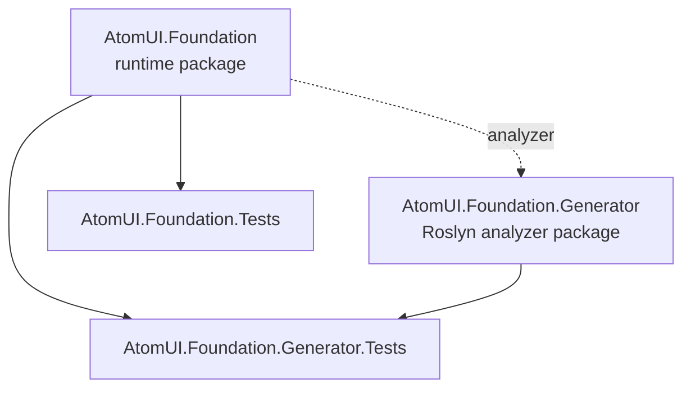
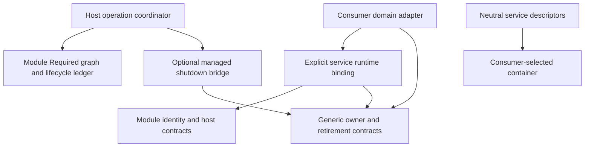

# Dependency Graph

AtomUI.Foundation has two package projects and two test projects. The runtime package owns public modularity primitives; the generator package is consumed only as a Roslyn analyzer.

This is the current project graph. The design below does not create new projects, packages or dependencies. Canonical responsibilities are indexed by [the architecture overview](overview.md).

## Rules

- `AtomUI.Foundation` may reference `AtomUI.Foundation.Generator` only as an analyzer with `ReferenceOutputAssembly="false"`.
- `AtomUI.Foundation.Generator` must not reference `AtomUI.Foundation`.
- Tests may reference the runtime package and, for generator coverage, the generator package.
- Generator package dependencies stay private with `PrivateAssets="all"`.

## Runtime Logical Dependencies

The explicit managed runtime is implemented in the 1.0.2 release within the existing runtime assembly. Logical layers do not imply separate assemblies:

- Lifetimes does not depend on Model, View, Command, document stores or platform controls. A source ModuleId may be retained without duplicating module resolution.
- The managed bridge connects real retirement tickets to the existing host. It must not introduce another ModuleHost or Required graph.
- Neutral descriptors remain exportable without activating a managed runtime. An external DI adapter must not create a second release authority for the same object.
- Domain adapters map their scopes and results to real leases; Foundation does not copy their data models or budget ledgers.
- New package boundaries and API signatures must be added to the canonical design before implementation. Microsoft DI is not a new mandatory runtime dependency.
