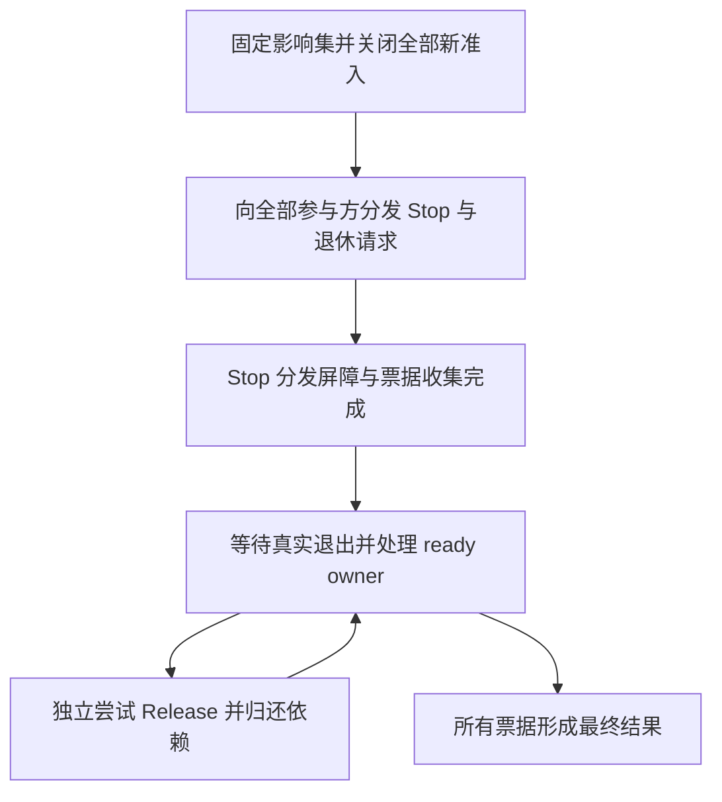

# 受管生命周期设计

本文是显式受管模式的正式行为合同，覆盖真实实例 owner、借用、scope 关联、退休和清理。已发布的 1.0.1 不包含这些运行时能力；1.0.2 在既有 `AtomUI.Foundation` 程序集的 `AtomUI.Lifetimes` 命名空间实现本分册末尾列出的公开 API。下列 API 与行为应保持一致；发布资格以[验证合同](../engineering/verification.md)的实际证据为准。

默认中立服务描述继续按[服务登记合同](service-registration.md)运行。启用受管模式后，服务释放只能由真实 owner 决定，模块回调结束、任务返回或取消发出都不能替代真实退出证据。

## 角色与关系

| 角色 | 权限与责任 |
| --- | --- |
| owner | 某个真实实例的唯一最终释放权威；保存来源、就绪条件、Release 与结果 |
| lease | 已准入使用者的真实保活凭证；可以归还，不能取得原实例关闭权 |
| 保留依赖 | owner A 长期使用 owner B 的关系，可在 A.Release 时才归还 |
| scope | 拥有/工作分组及显式关联边界；不自动构成父子 DI provider |
| 参与方 | 登记 Stop 与真实退出证据的模块/领域协调方 |
| 退休票据 | 同一次退休的首次快照、依赖与最终结果；不是立即完成的停止通知 |

ModuleId 标识来源模块，不代替实例 owner 身份。同一模块可以拥有多个 scope 和实例。owner 身份不能复用于仍被旧 lease 引用的新对象；多个服务别名指向原 owner，重复接管同一实例拒绝。

借用关系连接实际控制释放的权威。外部实例没有真实 owner 接入时，不能由裸引用制造“受管 lease”。普通 raw reference 也不因为存在旁路计数器就获得保活资格。

## 准入与使用

借用准入与 Active → Retiring 转换原子有序。转换后新借用为零，转换前已经准入的 lease 继续访问原实例，直到归还。重复归还和句柄复制不得重复减计数，最后归还不得在状态锁内执行用户 Release。

调用与结果可以分别持有同一实例的 lease。调用返回后，结果读者仍保有原实例；结果移交必须转移或新增真实借用，不依赖调用栈、GC 或对象只读性推断寿命。lease 归还后该句柄不能继续读取；框架不声称能拦截用户另外保存的裸引用。

短期调用/结果 lease 与长期捕获分开记录。前者表达实际在途使用，后者表达可在消费者释放时归还的依赖边。仅有 Module Required 图不能说明这些真实关系。

长期捕获必须可验证，拒绝不可自行归还的保留依赖环；不能把正常并发调用误判为永久环。隐藏在任意用户代码中的裸字段引用不获得受管资格。

## owner 状态与释放条件

| 状态角色 | 新准入 | 资源与结果 |
| --- | --- | --- |
| Active | 允许 | 正常服务，尚未请求退休 |
| Retiring | 拒绝 | 保持原对象，已发起 Stop，等待真实使用退出 |
| Releasing | 拒绝 | 释放前置已满足，正在执行唯一一次 Release |
| Released | 拒绝 | Release 成功，不再保留正文/服务负载或其依赖 |
| CleanupFailed | 拒绝 | Release 已尝试但失败，保留真实异常与可能仍使用的对象/依赖 |
| RetainedByFailedOwner | 拒绝 | 因失败消费者仍可能使用而保留，不伪报 Released |

这些状态由公开 `LifetimeOwnerState` 表达。进入 `Releasing` 前，本 owner 的真实 reader 和有效依赖消费者必须已经退出，且所有 `WaitForRelease` 前置 owner 均已释放。outgoing 保留依赖不要求在本 owner Release 前归零；Release 可以归还它们以推动上游 owner。

每个 owner 的最终 Release 最多尝试一次。没有本设计之外的显式恢复合同，不自动重试清理；成功项不能因兄弟项失败或调用方再次关闭而重新执行。

## 退休调度与两个屏障

第一屏障只证明完整影响集已关闭准入并收到 Stop。固定影响集包括模块选择、实际受管实例依赖和已登记领域参与方，不因没有 Module Required 边就遗漏真实借用者。

先关闭完整集合的所有准入，再执行用户停止逻辑。逐个向参与方发出非阻塞 Stop/退休请求，记录异常并继续其他参与方。停止请求不得在内部锁中调用用户代码，也不得等待另一个尚未获得 Stop 的参与方退出。需要异步退出时，返回真实票据，不在分发中等待其 FinalCompletion。

第一屏障之后，在调度锁外交错处理真实退出与就绪 owner 的释放。推进器以 owner 队列迭代处理可释放项；同步完成的 Release 只排入后续工作，不递归推进。一个 owner 的挂起不阻塞独立 ready owner。释放顺序由实际保留关系和就绪条件决定，不单靠模块逆序，不固定为所有 reader 一起归零后才开始任何释放。

第一屏障完成前，最后 lease 的归还只能记录就绪，不能自行执行 Release；否则可能在尚有参与方未收到 Stop 时提前销毁依赖或阻塞后续通知。

例如 A 长期持有 B，并只在 A.Release 中归还 B：A 自己的调用/结果 reader 退出后，可以先 Release A，再推动 B；若先全局等待 B.FinalCompletion，会导致 A 无法归还 B 的自依赖等待。

领域票据若要等待 Foundation owner 释放，必须显式表达此依赖并接入同一退休推进。不能把一个持有该 owner lease 的黑盒 FinalCompletion 设为其释放前置条件。无法表示或构成不可释放闭环的绑定应在准入前拒绝，不能用空票据或超时绕过。

第二屏障为最终结果汇总。Foundation 的关闭成功需要所有相关模块回调、参与方票据和受管 owner 都实际成功结束；单个 Shutdown 返回仅完成第一阶段的一部分。

## 失败保留与最终结果

各 ready owner 的 Release 独立捕获异常，继续其他独立且可释放的 owner。异常记录包含 owner 身份、来源模块、阶段和真实异常；成功项与失败项分别保存。

A.Release 失败且仍保留 B 时，A 及受管依赖闭包保持可达，B 标记 RetainedByFailedOwner/Blocked，不调用 B.Release。独立 C 继续处理；不能为“归零”释放仍可能被 A 使用的依赖。工厂在交接前失败也进入失败闭包，等待该 owner 释放的 owner 必须被标为保留。失败阻塞的 owner 后续新增捕获或被新增为 release prerequisite 时，相应依赖及 release-dependent 同步加入保留闭包。

真实在途读者与已知失败保留是不同状态：外部调用或结果 reader 尚未退出时仍为 Pending；这些读者退出后，已知失败闭包可以形成明确的失败最终报告，不必把它误当成必须永远归零的未知读者。该报告完成不表示闭包已释放。

| 关闭观察 | 含义 |
| --- | --- |
| 首次快照 | 停止意图已登记，报告当时已释放、清理失败及仍保留的 owner |
| FinalCompletion 成功 | 无实际在途使用、无清理失败、无保留 owner，相关释放已完成 |
| FinalCompletion 失败 | 实际在途读者已退出，但有失败及明确保留闭包；错误和资源仍须保留 |
| FinalCompletion 未完成 | 仍有真实使用或待推进退出，不得伪报终态 |

重复关闭返回同一退休操作和结果。调用方取消等待不取消实际清理；预算耗尽只停止本次等待、报告保留资源。非合作进程内调用不承诺被强制终止，最后 reader 未退出前不释放或复用资源。

若 Domain 已先完成关闭，尚未单独退休的 scope 复用该 Domain 的最终结果，以免 owner 记录清理后把既有清理失败报告成成功。

预算与隔离计费由消费端原账本负责。Foundation 必须保留可供该账本关联的实际 owner 状态，不能因关闭报告完成就假定资源额度可归还。根 runtime/provider 也不能在 finally 中绕过失败保留闭包执行强制 Dispose。

## scope 关联与外部所有者

scope 归属、关闭影响和服务解析共享是分开的关系。显式关联原 owner 不转移其释放权，也不创建同一服务的新实例。Core 可以把分组映射为 Composition、Model、View、Attach；Foundation 不定义这些领域类别。

双消费者示例：两个 View 使用一个 Model 服务 owner，工厂次数为 1。关闭 View1 只停止自身工作并归还其借用，Model 不因此退休；Model owner 请求退休后，关闭新借用并等待 View2、实际调用和结果 reader，再 Release 一次。

外部 owner 可以适配真实 acquire/return/retirement 能力；借用仍受原权威控制，适配器不能复制另一个最终释放者。Core 自有结果与数组保持其原有资源合同，只嵌入 Foundation 服务 lease。自有预算、文档提交或平台资源不下沉到本协议。

## Host 与外部容器接入

显式 Runtime 将上述协议接入唯一 ModuleHost。模块 Shutdown 桥可以只提交退休票据；Host 必须在最终关闭中推进和等待真实票据，不能在模块回调后直接释放 scope/provider。

受管实例不能同时由 Foundation owner 和外部 DI 自动释放。外部容器只有在证明构造、保活、逐 owner 清理及失败保留均符合本设计时才取得严格接入资格；标准 scope Dispose 的异常聚合包装不构成这种证明。

受管 owner 退休和注册撤销不等于完整模块集合热更新。候选 Prepare/Commit、代次原子发布及未受影响实例保持身份需要独立的模块变更事务设计，不能通过重建整个 Host 冒充。

## 必须验证的性质

结果 reader 保活、借用/关闭并发、A.Release 归还 B、失败依赖闭包、双 scope 共享、非合作读者和重复关闭均使用确定性 barrier 验证。完整矩阵及真实消费端要求见[验证合同](../engineering/verification.md)。只测计数器或仅有 Core-owned 替身不足以取得 Foundation-owned 服务资格。

## 运行时 API 合同

实现位于现有 AtomUI.Foundation 程序集中，命名空间为 `AtomUI.Lifetimes`，不新增包。公开合同采用以下名称；实现状态仍以测试证据更新。

- `LifetimeDomain`：`CreateScope()`；`Stop()` 冻结整个域准入并分发 Stop，尚不允许 Release；`CompleteRetirement()` 打开释放推进并返回同一 `LifetimeRetirement`；`BeginRetirement()` 组合 Stop 与 Complete；`IAsyncDisposable` 等待最终结果。
- `LifetimeScope`：`Own<T>(ModuleId, T, Func<T,ValueTask> release, Action<T>? stop=null)`；`Create<T>(ModuleId, Func<LifetimeOwner<T>,T> factory, Func<T,ValueTask> release, Action<T>? stop=null)`；`BeginRetirement()`；`IAsyncDisposable`。T 为 class，新增 API 不改变旧 instance 泛型约束。
- `LifetimeOwner`：非泛型基类，公开 `long Id`、`ModuleId ModuleId`、`LifetimeOwnerState State`、`LifetimeRetirement BeginRetirement()`、`void WaitForRelease(LifetimeOwner prerequisite)`；同域内显式记录必须在 prerequisite 最终释放后才可释放的关系，和 capture 释放顺序共同校验环。
- `LifetimeOwner<T>`：`LifetimeLease<T> AcquireLease()`；`LifetimeLease<TDependency> Capture<TDependency>(LifetimeOwner<TDependency>)`。Capture 接在当前 owner，不是独立裸引用计数；当前 owner 成功 Release 后自动归还剩余 capture，失败保留。
- `LifetimeLease<T>`：`T Value`、幂等 `Dispose()`；已准入 reader 在 owner Retiring 时仍有效，归还后读取拒绝。
- `LifetimeRetirement`：`Completion` 是全部 Stop 通知分发后的首次快照，`FinalCompletion` 是 owner 已释放或以失败/保留状态形成终态后的最终快照；重复退休共享原操作。
- `LifetimeOwnerState`：Active、Retiring、Releasing、Released、CleanupFailed、RetainedByFailedOwner。
- `LifetimeCloseResult`：不可变 `Owners` 快照、`Failures`，以及由是否无失败/保留决定的 `IsSuccess`。`LifetimeOwnerSnapshot` 保存 Id、ModuleId、State、Readers、IsConstructing、Dependencies 和 Failure；`LifetimeFailure` 保存 OwnerId、ModuleId、Stage 与 Exception。集合使用只读快照。
- `LifetimeCleanupException`：直接 Domain/Scope 的 DisposeAsync 在最终结果失败时抛出，`Result` 保留完整 LifetimeCloseResult；BeginRetirement 的结果任务仍以结构化失败返回，不吞掉失败或伪报成功。

Create 在运行 factory 前预留可追踪 owner 和构造准入；scope 同时退休也不能遗失返回的实例。用户 factory/Stop/Release 始终在状态锁外执行。Capture 在 Release 内归还时，实际依赖 pin 延迟到本次 Release 成功后解除，避免回调随后抛错造成上游早释放。一个 scope 请求退休时，同时关闭真实保留消费者的准入；向外借用的原 owner 不因消费者单独关闭而被接管。`LifetimeDomain` 与 `LifetimeScope` 的 `DisposeAsync` 等待最终结果，并在存在清理失败或保留 owner 时以 `LifetimeCleanupException.Result` 保留完整结果。
