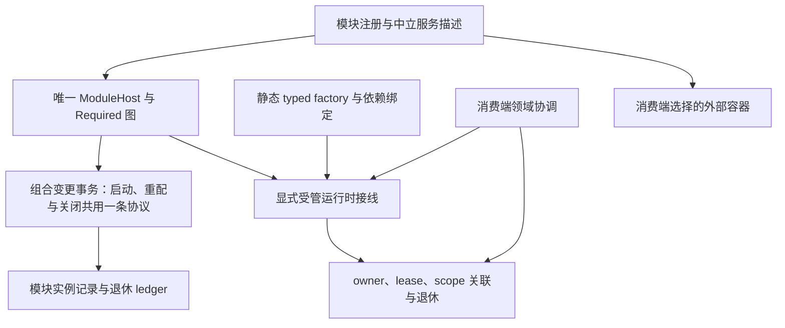

# AtomUI.Foundation 架构总览

AtomUI.Foundation 为 AtomUI 生态提供模块身份、Required 依赖解析、模块宿主、中立服务描述与源码生成。正式架构在这一基础上增加显式启用的受管生命周期与同一 Host 模块动态重配事务，使服务借用、退休与领域联合提交具有明确边界。工作区实现与已发布版本分别记账。

本目录的非日期设计分册是架构权威。日期方案、评估和审计保存决策依据与当时的实现证据；发生冲突时，以正式设计分册为准。

2026-11-04 [架构审计](../engineering/2026-11-04-foundation-architecture-audit.md)及原 scope 泄漏触发的修复沿用现有分层，补足恢复失败隔离、用户回调边界、真实失败图的收缩、成功历史裁剪及生成器引用身份。上述目标已进入各正式分册；实现和原联合场景是否通过仍须由本次新证据确认，不能沿用 1.0.3 历史资格标为已修复。

本轮工作区修复已取得[独立新证据](../engineering/evidence/architecture-remediation-20261104.json)：Release 双目标构建 0 警告/错误，运行时 200/200、生成器 48/48；同一唯一候选的 net8/net10 JIT、trim、osx-arm64 Native AOT 六条路径通过。原 LuminEditor 50 轮预热加 1000 轮完整文档场景发现 1 项并通过，托管净增长 36,696 bytes（原门槛 1,048,576），逐轮费用残留及最终费用均为 0；相关 Core 84/84、真实联合消费者 1/1 通过。候选为 `1.0.3-audit.g18d7b12e3343`，这些是尚未提交、未正式发布的工作区资格，公开 1.0.3 不包含本轮修复。下游任务账本未在本仓库变更。

2026-11-05 在相同修复源码上将版本设为 `1.0.4-local.1`，清理旧 Foundation 本地包及全局包缓存后，两个包已发布至配置的 `AtomUILocal`。新版本 Release 双目标构建和 200/48 套件通过；从该本地源实际恢复的生成器配置及 net8/net10 消费程序运行通过，包/程序集哈希一致。[本地发布记录](../engineering/evidence/local-release-20261105-1.0.4-local.1.json)单独保存；此操作不包含 Git 提交或公开 NuGet 发布，也不把旧候选的 AOT/联合证据记成新版本重跑。

2026-11-05 在上述修复之上完成一轮边界内部的结构评估，形成[架构优化重构方案](2026-11-05-foundation-architecture-optimization-proposal.md)：统一启动、重配与关闭为同一组合变更事务，为 Transient 建立请求 owner 释放触发，合并退休簿记为单一 ledger，收敛锁层级与阻塞等待，修正生成器增量缓存与 SDK 兼容，并补齐公开 API 基线、AOT 注解与发布门禁。该方案已于同日批准，各正式分册已按其第 8 节完成修订；修订后的合同描述实现必须满足的目标行为，实现与资格仍须由新证据确认。版本状态移至 [CHANGELOG](../../CHANGELOG.md)。

2026-11-05 方案 P0–P5 实施完成后，版本设为 `1.0.4`，公开 API 基线并入 `PublicAPI.Shipped.txt`。发布资格与尚待取得的证据见 [CHANGELOG](../../CHANGELOG.md)。

## 设计入口

| 文档 | 权威范围 |
| --- | --- |
| [模块系统与宿主](modularity.md) | 身份、依赖图、显式启用、阶段、取消、回滚与关闭 |
| [模块动态重配事务](module-reconfiguration.md) | 候选隔离、基线校验、联合提交、准入恢复及局部退休；1.0.3 实现；产品接入另行验收 |
| [服务登记与运行时接线](service-registration.md) | 中立描述兼容、外部容器、显式受管激活、typed factory 与所有权交接 |
| [受管生命周期](managed-lifetimes.md) | 实例 owner、真实 lease、scope 关联、退休屏障与失败保留 |
| [源码生成](source-generation.md) | 模块发现、可生成类型、诊断、属性桥接与跨程序集导出 |
| [依赖图](dependency-graph.md) | 项目引用及内部逻辑依赖方向 |
| [构建与打包](build-and-packaging.md) | 当前目标框架、构建输入、包形态与消费验证 |
| [验证合同](../engineering/verification.md) | 正式行为矩阵、兼容消费者、性能与发布资格 |

## 实现状态

设计合同描述实现必须满足的行为，不代表某次发布已取得全部资格。各版本的实现状态、证据链接与行为变化集中记录在 [CHANGELOG](../../CHANGELOG.md)；下表只列能力与正式目标。即使某次包验证通过，也不能据此推断下游产品已经接入或跨平台资格已经全部完成。

| 能力 | 正式目标 |
| --- | --- |
| 模块身份、描述、Required 图、显式启用 | 保留身份与单一图权威 |
| Host 生命周期 | 启动、重配与关闭为同一组合变更事务；回调锁外执行；单一状态权威 |
| 中立服务描述和 instance 查找 | 保留登记、冻结、导出及调用方所有权 |
| 显式受管服务与生命周期 | 显式启用、唯一释放权威、Transient 请求 owner、单一退休 ledger；跨平台与产品接入按验证合同取证 |
| 模块目录生成器 | 兼容既有输出，增量缓存有效，覆盖运行时支持的全部 SDK |
| 验证与诊断 | 结构化错误、失败隔离、并发压力与复杂度基准、公开 API 基线与发布门禁 |
| 模块集合动态变更事务 | [动态重配合同](module-reconfiguration.md)；产品接入另行验收 |

1.0.2 的受管运行时继续位于既有 `AtomUI.Foundation` 程序集，不增加运行时 DI 依赖或独立包。具体公开签名见[服务登记与运行时接线](service-registration.md)及[受管生命周期](managed-lifetimes.md)。1.0.1 不包含这些符号。

2026-11-03 本地 1.0.3 包在组合视图、候选隔离和批量退休的基础上，修正了已发布领域状态持有模块 lease 时的退休等待循环。此前 168 项测试未覆盖这一入口，不能据其通过认定完整退休资格。修正后 Release 双目标构建为 0 警告/错误，运行时 170/170、生成器 37/37；原始探针保持相同源码，在手动归还 lease 前已完成退休。同一独立包消费者的 net8/net10 JIT、裁剪及 Native AOT 均在本机 macOS arm64 实际运行。两个 1.0.3 包已推送配置的本地 NuGet 源，详细事实集中见[本地前置记录](../engineering/evidence/module-reconfiguration-20261103-local-1.0.3.json)。该本地批次不包含公开 NuGet 或发布提交；正式发布由版本工作流单独验证。真实 Core 联合接入仍未完成，不关闭对应下游阻塞或其他平台资格。

## 分层与所有权

模块身份、Required 图和通用 Host 只有一套。实例保活关系记录真实 owner 之间的使用，不重建另一套 Module 图。默认中立模式不创建 provider 或 owner；受管模式必须显式接线，启用后只有一个解析与释放权威。

Foundation 负责通用服务实例的寿命证据。Model、View、命令、Undo、文档结果、Token、Frame 和平台资源保持消费端所有；领域票据与服务 lease 通过明确协议关联。消费端预算继续由原账本负责，Foundation 不新增预算根。

动态重配沿用上述权威：Foundation 准备模块和服务，消费端准备领域配置，双方经同一次决定发布一致的组合视图。提交前可恢复的准入暂停与提交后不可逆退休分开；未受影响实例保持身份。具体顺序、失败及取消合同仅由[动态重配分册](module-reconfiguration.md)定义，不改变 1.0.2 的静态输入快照和幂等初始化行为。

## 项目边界

| 项目 | 职责 |
| --- | --- |
| `AtomUI.Foundation` | 模块与服务描述、显式受管服务运行时及生命周期 owner |
| `AtomUI.Foundation.Generator` | Roslyn 增量生成器，提供模块目录和相关诊断 |
| `AtomUI.Foundation.Tests` | 运行时行为与兼容合同回归 |
| `AtomUI.Foundation.Generator.Tests` | 生成源、诊断位置和输出编译回归 |

运行时对 Generator 的引用仅为 analyzer；Generator 不引用运行时程序集。新的逻辑层不自动代表新增项目或包，也不默认引入 Microsoft DI 运行时依赖。

## 决策与证据

- [统一重构方案与阶段安排](2026-10-26-foundation-refactor-proposal.md)
- [生命周期扩展评估](2026-10-26-foundation-lifetime-extension-assessment.md)
- [完整性与消费端审计](../engineering/2026-10-26-foundation-completeness-audit.md)
- [2026-11-04 架构审计](../engineering/2026-11-04-foundation-architecture-audit.md)
- [架构优化重构方案](2026-11-05-foundation-architecture-optimization-proposal.md)

以上记录不是产品完成清单。实现状态的提升必须对应当前版本的新验证证据。
