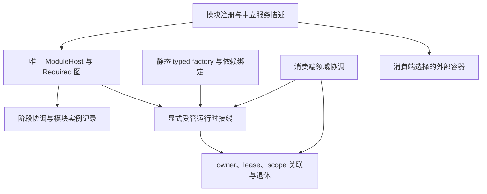

# AtomUI.Foundation 架构总览

AtomUI.Foundation 为 AtomUI 生态提供模块身份、Required 依赖解析、模块宿主、中立服务描述与源码生成。正式架构在这一基础上增加显式启用的受管生命周期，使服务借用、共享 owner、退休和清理具有统一合同。

本目录的非日期设计分册是架构权威。日期方案、评估和审计保存决策依据与当时的实现证据；发生冲突时，以正式设计分册为准。

## 设计入口

| 文档 | 权威范围 |
| --- | --- |
| [模块系统与宿主](modularity.md) | 身份、依赖图、显式启用、阶段、取消、回滚与关闭 |
| [服务登记与运行时接线](service-registration.md) | 中立描述兼容、外部容器、显式受管激活、typed factory 与所有权交接 |
| [受管生命周期](managed-lifetimes.md) | 实例 owner、真实 lease、scope 关联、退休屏障与失败保留 |
| [源码生成](source-generation.md) | 模块发现、可生成类型、诊断、属性桥接与跨程序集导出 |
| [依赖图](dependency-graph.md) | 项目引用及内部逻辑依赖方向 |
| [构建与打包](build-and-packaging.md) | 当前目标框架、构建输入、包形态与消费验证 |
| [验证合同](../engineering/verification.md) | 正式行为矩阵、兼容消费者、性能与发布资格 |

## 实现状态

设计合同描述实现必须满足的行为，不代表某次发布已取得全部资格。已发布 1.0.1 基线对应源码 `0041863`；本次 1.0.2 发布范围包含下表所列实现，包级验证通过后由仓库发布工作流交付。即使本次包验证通过，也不能据此推断下游产品已经接入或跨平台资格已经全部完成。

| 能力 | 1.0.1 发布基线 | 1.0.2 发布范围 | 正式目标 |
| --- | --- | --- |
| 模块身份、描述、Required 图、显式启用 | 已实现 | 已实现并有回归覆盖 | 保留身份与单一图权威 |
| Host 生命周期 | 已有主流程，边界行为有限 | 协调、异步创建、预检、取消、回滚和关闭结果已实现；Release 运行时套件 102/102 通过 | 保持回调锁外执行及单一状态权威 |
| 中立服务描述和 instance 查找 | 已实现 | 已实现并保持兼容 | 保留登记、冻结、导出及调用方所有权 |
| 显式受管服务与生命周期 | 尚未实现 | typed factory、唯一 owner、真实 lease、scope 关联、退休屏障和失败保留已实现；net8/net10 包消费、trim 与 macOS arm64 Native AOT 本机验证通过 | 保持显式启用及唯一释放权威；跨平台与产品接入仍待验证 |
| 模块目录生成器 | 已实现常规路径 | partial/类型形状、名称引用、诊断和 ProjectReference/PackageReference 配置桥已实现；Release 测试 37/37 及六种真实消费配置通过 | 兼容既有输出并覆盖真实 SDK 配置 |
| 验证与诊断 | 已有局部实现 | 结构化错误、失败隔离和本机包消费者验证入口已实现；Linux CI、其他平台与产品接入仍待资格确认 | 按验证合同逐级取得证据 |
| 模块集合动态变更事务 | 尚未实现 | 未实现 | 属于单独设计范围；owner 退休不代表事务能力 |

1.0.2 的受管运行时继续位于既有 `AtomUI.Foundation` 程序集，不增加运行时 DI 依赖或独立包。具体公开签名见[服务登记与运行时接线](service-registration.md)及[受管生命周期](managed-lifetimes.md)。1.0.1 不包含这些符号。

## 分层与所有权

模块身份、Required 图和通用 Host 只有一套。实例保活关系记录真实 owner 之间的使用，不重建另一套 Module 图。默认中立模式不创建 provider 或 owner；受管模式必须显式接线，启用后只有一个解析与释放权威。

Foundation 负责通用服务实例的寿命证据。Model、View、命令、Undo、文档结果、Token、Frame 和平台资源保持消费端所有；领域票据与服务 lease 通过明确协议关联。消费端预算继续由原账本负责，Foundation 不新增预算根。

## 项目边界

| 项目 | 职责 |
| --- | --- |
| `AtomUI.Foundation` | 模块与服务描述、显式受管服务运行时及生命周期 owner |
| `AtomUI.Foundation.Generator` | Roslyn 增量生成器，提供模块目录和相关诊断 |
| `AtomUI.Foundation.Tests` | 运行时行为与兼容合同回归 |
| `AtomUI.Foundation.Generator.Tests` | 生成源、诊断位置和输出编译回归 |

运行时对 Generator 的引用仅为 analyzer；Generator 不引用运行时程序集。新的逻辑层不自动代表新增项目或包，也不默认引入 Microsoft DI 运行时依赖。

## 决策与证据

- [统一重构方案与阶段安排](2026-10-26-foundation-refactor-proposal.md)
- [生命周期扩展评估](2026-10-26-foundation-lifetime-extension-assessment.md)
- [完整性与消费端审计](../engineering/2026-10-26-foundation-completeness-audit.md)

以上记录不是产品完成清单。实现状态的提升必须对应当前版本的新验证证据。
